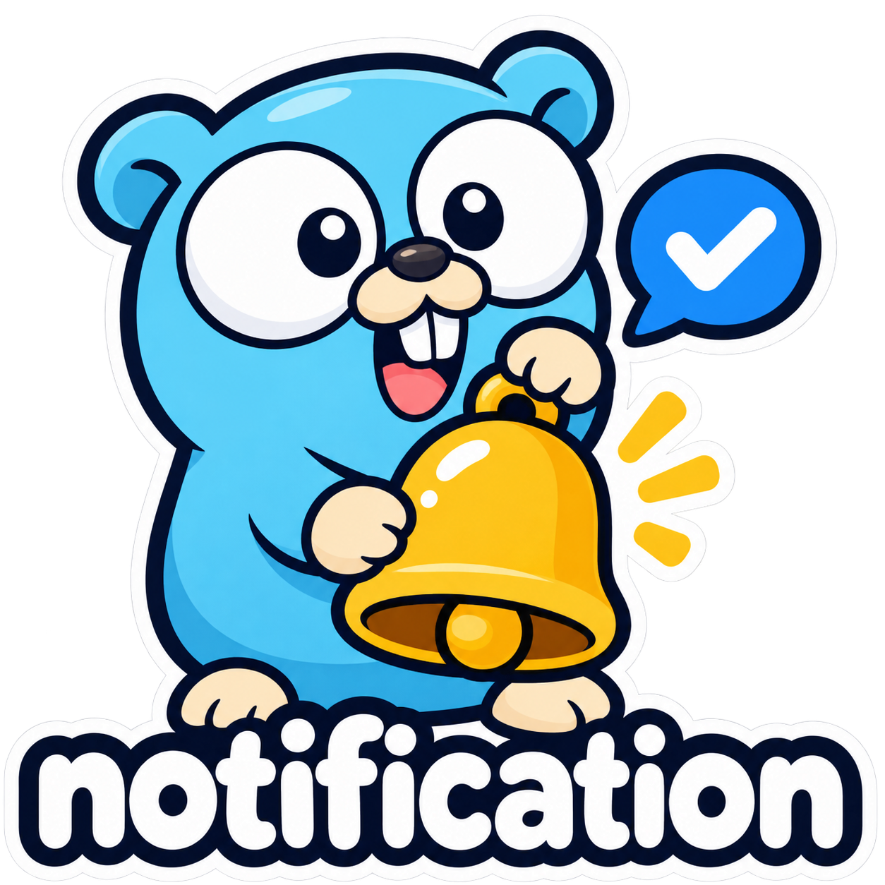

<p align="center">
  
</p>

<p align="center">Send notifications in Go with a title, a body, and a configured driver.</p>

<p align="center">
  <a href="https://github.com/goforj/notification/actions/workflows/ci.yml"></a>
  <a href="https://github.com/goforj/notification/actions/workflows/security.yml"></a>
  
  
  <a href="LICENSE"></a>
  <a href="docs/unit-results.json"></a>
  <a href="docs/unit-results.json"></a>
  <a href="docs/integration-results.json"></a>
</p>

<p align="center"><a href="#features">Features</a> · <a href="#quick-start">Quick Start</a> · <a href="#drivers">Drivers</a> · <a href="#runnable-examples">Examples</a> · <a href="#api-index">API</a></p>

## Features

<table>
<thead><tr><th align="left" width="220">Feature</th><th align="left">What you get</th></tr></thead>
<tbody>
<tr><td width="220" nowrap> <strong>Simple messages</strong></td><td>Send a title and body through a configured driver.</td></tr>
<tr><td width="220" nowrap> <strong>Recipient policy</strong></td><td>Resolve scoped recipients and apply channel policy.</td></tr>
<tr><td width="220" nowrap> <strong>Typed channels</strong></td><td>Pair typed renderers and transports.</td></tr>
<tr><td width="220" nowrap> <strong>Explicit identity</strong></td><td>Optional process-local deduplication preserves accepted channels.</td></tr>
<tr><td width="220" nowrap> <strong>Safe diagnostics</strong></td><td>Keep endpoints and message content out of errors and logs.</td></tr>
<tr><td width="220" nowrap> <strong>Isolated testing</strong></td><td>Capture messages through the Sender interface.</td></tr>
</tbody>
</table>

## Quick Start

Requires Go 1.24+. This is an unreleased library. From the local checkout:

```sh
cd ~/code/notification
go run ./examples/quickstart
```

Configure a driver once, then send a message:

```go
driver := log.New(slog.New(slog.NewTextHandler(io.Discard, nil)))
notifier := notification.New(driver)

err := notifier.Send(context.Background(), notification.Message{
	Title: "Ticket updated",
	Body:  "Ticket T-42 has a new owner.",
})
if err != nil {
	panic(err)
}
fmt.Println("message captured")
// message captured
```

The log driver captures locally. A nil error means the driver handled the message; it never proves recipient delivery. Send performs no retries or background work.

## Drivers

<table>
<thead><tr><th align="left" width="260">Driver</th><th align="left">Acceptance</th><th align="left">Verification</th></tr></thead>
<tbody>
<tr><td width="260" nowrap> <a href="driver/dingtalk"><strong>DingTalk</strong></a></td><td>Robot response code</td><td>Protocol tests</td></tr>
<tr><td width="260" nowrap> <a href="driver/discord"><strong>Discord</strong></a></td><td>Message ID</td><td>Protocol tests</td></tr>
<tr><td width="260" nowrap> <a href="driver/mail"><strong>Mail</strong></a></td><td>Mailer acceptance</td><td>Composition tests</td></tr>
<tr><td width="260" nowrap> <a href="driver/feishu"><strong>Feishu</strong></a></td><td>Bot response code</td><td>Protocol tests</td></tr>
<tr><td width="260" nowrap> <a href="driver/googlechat"><strong>Google Chat</strong></a></td><td>Message resource</td><td>Protocol tests</td></tr>
<tr><td width="260" nowrap> <a href="driver/gotify"><strong>Gotify</strong></a></td><td>Message ID and content</td><td>Gotify 3.1.1</td></tr>
<tr><td width="260" nowrap> <a href="driver/jsm"><strong>Jira Service Management</strong></a></td><td>Async request ID</td><td>Protocol tests</td></tr>
<tr><td width="260" nowrap> <a href="driver/line"><strong>LINE</strong></a></td><td>Push acknowledgement</td><td>Protocol tests</td></tr>
<tr><td width="260" nowrap> <a href="driver/log"><strong>Log</strong></a></td><td>Local capture</td><td>Local capture</td></tr>
<tr><td width="260" nowrap> <a href="driver/ntfy"><strong>ntfy</strong></a></td><td>Message ID and topic</td><td>ntfy 2.37.2</td></tr>
<tr><td width="260" nowrap> <a href="driver/opsgenie"><strong>Opsgenie</strong></a></td><td>Async request ID</td><td>Protocol tests</td></tr>
<tr><td width="260" nowrap> <a href="driver/pagerduty"><strong>PagerDuty</strong></a></td><td>Event and incident key</td><td>Protocol tests</td></tr>
<tr><td width="260" nowrap> <a href="driver/slack"><strong>Slack</strong></a></td><td>ok acknowledgement</td><td>Protocol tests</td></tr>
<tr><td width="260" nowrap> <a href="driver/teams"><strong>Teams</strong></a></td><td>HTTP acceptance</td><td>Protocol tests</td></tr>
<tr><td width="260" nowrap> <a href="driver/telegram"><strong>Telegram</strong></a></td><td>Message ID</td><td>Protocol tests</td></tr>
<tr><td width="260" nowrap> <a href="driver/twilio"><strong>Twilio</strong></a></td><td>Message SID and status</td><td>Protocol tests</td></tr>
<tr><td width="260" nowrap> <a href="driver/waha"><strong>WAHA</strong></a></td><td>HTTP acceptance</td><td>Protocol tests</td></tr>
<tr><td width="260" nowrap> <a href="driver/webhook"><strong>Webhook</strong></a></td><td>HTTP acceptance</td><td>Protocol tests</td></tr>
<tr><td width="260" nowrap> <a href="driver/wecom"><strong>WeCom</strong></a></td><td>Robot response code</td><td>Protocol tests</td></tr>
<tr><td width="260" nowrap> <a href="driver/whapi"><strong>Whapi</strong></a></td><td>Send acknowledgement</td><td>Protocol tests</td></tr>
</tbody>
</table>

All drivers have local tests. ntfy and Gotify also pass real-server tests; hosted and paired-session verification remains pending for other providers. See [driver configuration and delivery contracts](docs/drivers.md) for details and [integration evidence](docs/integration-results.json) for exact server versions.

Mail supports SMTP through its configured Mailer. Teams uses Workflows, LINE uses the Messaging API, and Opsgenie provides legacy integration support.

The root module uses only the standard library. Mail is an optional module using goforj/mail v0.3.1. Drivers own their configured destinations; a `Message` contains only content. Errors preserve safe cancellation and provider classifications without returning provider prose. See [delivery contracts](docs/contracts.md) for bounds and ownership.

## Installation

Until tags are published, consumers can use the local checkout:

```sh
go mod edit -require=github.com/goforj/notification@v0.0.0
go mod edit -replace=github.com/goforj/notification=$HOME/code/notification
go mod tidy
```

HTTP providers and the log driver are included in the root module:

```go
import "github.com/goforj/notification"
import "github.com/goforj/notification/driver/log"
import "github.com/goforj/notification/driver/webhook"
```

For Slack-compatible transport, configure the trusted URL once:

```go
driver, err := webhook.New(webhook.Config{
    URL:    configuredWebhookURL,
    Format: webhook.Slack,
})
```

The optional Mail adapter needs an additional local module requirement:

```sh
go mod edit -require=github.com/goforj/notification/driver/mail@v0.0.0
go mod edit -replace=github.com/goforj/notification/driver/mail=$HOME/code/notification/driver/mail
go mod tidy
```

It borrows an ordinary `*mail.Mailer` and configured recipients. Mail continues to own sender defaults, email composition, and transport.

## Runnable Examples

| Program | Run from the repository root | Demonstrates |
| --- | --- | --- |
| [Quick start](examples/quickstart/main.go) | `go run ./examples/quickstart` | A title and body through the log driver |
| [Webhook](examples/webhook/main.go) | `go run ./examples/webhook` | A message sent to a configured local HTTP provider |
| [Mail](examples/mail/main.go) | `cd examples/mail && go run .` | Mail defaults and a configured recipient with a fake transport |
| [Fake](examples/fake/main.go) | `go run ./examples/fake` | Application testing through Sender |
| [Composition](examples/composition/main.go) | `go run ./examples/composition` | Fanout, conservative fallback and safe retry advice |
| [Incident](examples/incident/main.go) | `go run ./examples/incident` | Stable lifecycle keys with a local PagerDuty protocol fixture |
| [Advanced fallback](examples/fallback/main.go) | `go run ./examples/fallback` | Optional recipient planning, fallback, and identity |

The runner discovers and executes every program and verifies the expected output immediately after each print call. Child programs participate in coverage and race runs. Local tests verify webhook wire behavior and Mail composition; they make no hosted-provider delivery claim.

## API Index

| API | Example |
| --- | --- |
| [New](#quick-start) | Quick Start |
| [Fanout](#composition) | Composition |
| [Fallback](#composition) | Composition |
| [DeliveryError.RetryAfter](#composition) | Composition |
| [pagerduty.Driver.Trigger](#incident-lifecycle) | Incident lifecycle |
| [pagerduty.Driver.Acknowledge](#incident-lifecycle) | Incident lifecycle |
| [pagerduty.Driver.Resolve](#incident-lifecycle) | Incident lifecycle |
| [Notifier.Send](#quick-start) | Quick Start |
| [webhook.New](#webhook-delivery) | Webhook delivery |
| [notificationfake.New](#application-testing) | Application testing |
| [Fake.Messages](#application-testing) | Application testing |
| [notificationmail.New](#mail-delivery) | Mail delivery |

## Webhook delivery

The URL is driver configuration. `AllowPrivate` below permits the local test server; the default destination policy rejects private and special addresses.

```go
provider := httptest.NewServer(http.HandlerFunc(func(w http.ResponseWriter, r *http.Request) {
	w.WriteHeader(http.StatusAccepted)
}))
defer provider.Close()

driver, err := webhook.New(webhook.Config{
	URL:          provider.URL,
	AllowPrivate: true,
})
if err != nil {
	panic(err)
}
defer driver.Close()

notifier := notification.New(driver)
err = notifier.Send(context.Background(), notification.Message{
	Title: "Ticket updated",
	Body:  "Ticket T-42 has a new owner.",
})
if err != nil {
	panic(err)
}
fmt.Println("message accepted")
// message accepted
```

## Composition

Use ordinary senders for application-level fanout or conservative fallback. Fanout attempts every target with at most eight concurrent calls. Fallback advances only after permanent rejection, unauthorized access or unsupported rendering; uncertainty and transient failures stop it to avoid accidental duplicates. Both borrow one to 64 configured senders and never retry.

```go
chat := notificationfake.New()
push := notificationfake.New()
sender := notification.New(notification.Fanout(chat, push))
message := notification.Message{
	Title: "Monitor down",
	Body:  "API health check failed.",
}
if err := sender.Send(context.Background(), message); err != nil {
	panic(err)
}
fmt.Println("captured targets:", len(chat.Messages())+len(push.Messages()))
// captured targets: 2

chat.Respond(notification.ErrPermanent)
backup := notification.New(notification.Fallback(chat, push))
if err := backup.Send(context.Background(), message); err != nil {
	panic(err)
}
fmt.Println("backup captures:", len(push.Messages()))
// backup captures: 2

push.Respond(notification.NewDeliveryError("push", notification.Outcome{
	Status:     notification.Failed,
	RetryAfter: 30 * time.Second,
}, notification.ErrThrottled))
err := notification.New(push).Send(context.Background(), message)
var failure *notification.DeliveryError
if errors.As(err, &failure) {
	fmt.Println("retry advice:", failure.RetryAfter())
	// retry advice: 30s
}
```

## Incident lifecycle

PagerDuty, JSM and legacy Opsgenie additionally implement `IncidentSender`. Construct keys from stable scoped IDs and use the same key for trigger, acknowledge and resolve. Ordinary `Send` requires a fixed configured key on these drivers. JSM and Opsgenie return asynchronous acceptance, without polling for completion.

```go
ctx := context.Background()
key := notification.IncidentKey("tenant:42:monitor:17")
err = driver.Trigger(ctx, notification.Incident{
	Key:      key,
	Title:    "API unavailable",
	Body:     "Health check failed.",
	Source:   "health-checks",
	Severity: notification.SeverityCritical,
})
if err != nil {
	panic(err)
}
fmt.Println("trigger accepted by local fixture")
// trigger accepted by local fixture

if err := driver.Acknowledge(ctx, key); err != nil {
	panic(err)
}
if err := driver.Resolve(ctx, key); err != nil {
	panic(err)
}
fmt.Println("acknowledge and resolve use the same stable key")
// acknowledge and resolve use the same stable key
```

## Mail delivery

Configure the recipient on the Mail adapter. This example uses Mail's fake, so it sends no real email.

```go
transport := mailfake.New()
mailer := mail.New(transport, mail.WithDefaultFrom("sender@example.com", "Helpdesk"))
driver := notificationmail.New(mailer, "recipient@example.com")
notifier := notification.New(driver)

err := notifier.Send(context.Background(), notification.Message{
	Title: "Ticket updated",
	Body:  "Ticket T-42 has a new owner.",
})
if err != nil {
	panic(err)
}
fmt.Println("captured mail:", transport.SentCount())
// captured mail: 1
```

## Application testing

Application services depend on `notification.Sender`. The fake validates and captures messages without contacting providers. Use `fake.Respond(err)` to test a failure.

```go
fake := notificationfake.New()
var sender notification.Sender = fake

err := sender.Send(context.Background(), notification.Message{
	Title: "Ticket updated",
	Body:  "Ticket T-42 has a new owner.",
})
if err != nil {
	panic(err)
}
fmt.Println("captured messages:", len(fake.Messages()))
// captured messages: 1
```

## Advanced dispatch

Applications that need recipient lookup, preferences, localized templates, fallback, or deduplication can use `NewDispatcher`. These capabilities are optional and keep their explicit delivery results. See [advanced dispatch](docs/advanced.md) for the complete runnable example and migration from the earlier API.

## Development

```sh
make test
make test-race
make test-integration # Requires Docker.
make vet
make check-generated
make security
```

Documentation is generated by the Go tools in `docs/`, using the runnable examples as the source of truth. `make test` validates every module, executes the example programs, and enforces exact 100% library unit statement coverage. See [development and release](docs/development.md) for independent module tags and [delivery contracts](docs/contracts.md) for guarantees and limits.

The [original framework proposal](docs/designs/framework-proposal.md) records the larger roadmap. Durable Queue integration, SQL persistence, inboxes, and GoForj generation remain future work.
